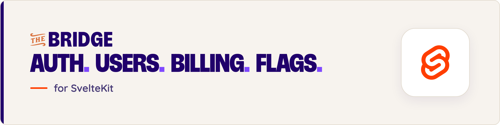

<p align="center">
  <a href="https://thebridge.dev/?utm_source=github&utm_medium=readme&utm_campaign=bridge-svelte"><picture><source media="(prefers-color-scheme: dark)" srcset="https://raw.githubusercontent.com/thebridgedev/bridge-svelte/main/.github/assets/banner.png"></picture></a>
</p>

<p align="center">
  <a href="https://www.npmjs.com/package/@nebulr-group/bridge-svelte"></a>
  <a href="https://github.com/thebridgedev/bridge-svelte/blob/main/LICENSE"></a>
  <a href="https://madewithsvelte.com/p/the-bridge/shield-link"></a>
</p>

<p align="center">
  <a href="https://thebridge.dev/?utm_source=github&utm_medium=readme&utm_campaign=bridge-svelte"><b>Website</b></a> ·
  <a href="https://thebridge.dev/docs/quickstart/svelte/?utm_source=github&utm_medium=readme&utm_campaign=bridge-svelte"><b>Quickstart</b></a> ·
  <a href="https://thebridge.dev/docs/?utm_source=github&utm_medium=readme&utm_campaign=bridge-svelte"><b>Docs</b></a> ·
  <a href="https://thebridge.dev/docs/ai-assistants/mcp/?utm_source=github&utm_medium=readme&utm_campaign=bridge-svelte"><b>Set up with your AI assistant</b></a>
</p>

# The Bridge for SvelteKit

`@nebulr-group/bridge-svelte` adds sign-in in your own pages, workspaces, flag-based route guards, plans and checkout, the team panel and live updates to a SvelteKit 2 + Svelte 5 app, with one `.env` line and three files.

> **This is the 1.0 alpha**, built on `@nebulr-group/bridge-auth-core` 1.0 and the new Bridge API. It installs from the `alpha` tag; `latest` stays on 0.x until 1.0.0. It runs in the browser (`ssr = false`) and signs people in with email and password.

**[The Bridge](https://thebridge.dev/?utm_source=github&utm_medium=readme&utm_campaign=bridge-svelte)** is a hosted backend for SaaS apps: sign-in, multi-tenant workspaces, Stripe subscriptions with plan limits, and feature flags, managed from one dashboard.

## Install

```sh
bun add @nebulr-group/bridge-svelte@alpha
```

## The whole integration

```sh
# .env: the issuer from your app's settings in Bridge
PUBLIC_BRIDGE_ISSUER=https://…/identity-access/apps/<your app id>
```

```ts
// src/routes/+layout.ts
import { bridgeBootstrap } from '@nebulr-group/bridge-svelte';
export const ssr = false;
export const load = bridgeBootstrap({ rules: [{ match: '/', public: true }] });
```

```svelte
<!-- src/routes/+layout.svelte -->
<script lang="ts">
  import '@nebulr-group/bridge-svelte/styles';
  import { BridgeBootstrap } from '@nebulr-group/bridge-svelte';
  let { children } = $props();
</script>

<BridgeBootstrap>{@render children()}</BridgeBootstrap>
```

```svelte
<!-- src/routes/auth/[...bridge]/+page.svelte -->
<script lang="ts">
  import { BridgeAuthRoutes } from '@nebulr-group/bridge-svelte';
</script>

<BridgeAuthRoutes />
```

In your app's settings in Bridge, add your app's address as a browser address and `https://<your app>/auth` as its email-links address. See the [Quickstart](learning/quickstart/quickstart.md).

## What it gives you

| Area | Pieces |
|---|---|
| Sign-in | `BridgeAuthRoutes` (sign-in, sign-up, verify-email, forgot-password, set-password, invite, workspaces, handoff), `SignInForm`, `SignUpForm`, `VerifyEmail`, `ForgotPassword`, `SetPassword`, `InviteLanding`, `WorkspaceChooser`, `SignOutButton`, `ProfileName` |
| Gates | route `rules`, `FeatureFlag`, `useFlag`, `flag`, `requireFlag`, the paywall: all on flag results, never a role or the plan |
| Billing | `BridgeBillingRoutes`, `PlanPicker`, `BillingPortalButton`, `SubscriptionStatus`, `BillingNotice`, `QuotaBanner`, `CheckoutNotice`, `UpgradeDialog`, `bridgeFetch` |
| Team | `TeamPanel`, `MemberList`, `InviteDialog`, `InviteList`, `EditMemberDialog`, `WorkspaceForm`, `ProfileForm` |
| State | `session`, `user`, `workspace`, `workspaces`, `me`, `flags`, `billing`, `plans`, `usage`, `liveStatus`, `getBridge()` |
| Server | `@nebulr-group/bridge-svelte/server`: `bridgeHandle`, `requireActor`, `meter`, `flagsFor` |
| Hand-off | `HandoffSignIn`, `readHandoff`, `handoffSignIn`: a sign-in page for a command-line tool |

All the guides: [learning/](learning/README.md).

## Demo application

`demo/` is a small helpdesk on the plugin, and what the Playwright suite drives. It imports the plugin from source.

```sh
# in a container, from the repo root
bun install
PUBLIC_BRIDGE_ISSUER=https://…/identity-access/apps/<app id> bun run dev
```

## End-to-end tests (Playwright)

```sh
bunx playwright test
```

By default the suite starts a local issuer (`e2e/harness/fake-issuer.ts`: auth-core's fake issuer over HTTP, with a small control API the tests use to set the scene) and the demo pointed at it, and runs every spec one at a time. To run against a real issuer, a local Bridge or a stage:

```sh
E2E_ISSUER=https://…/identity-access/apps/<app id> bunx playwright test
```

`E2E_BASE_URL` points at a demo that is already running. The local issuer does not sign its tokens, so the server-side token check is proven only against a real issuer.

## Publishing and releases

The 1.0 line lives on the `v1` branch and is published as `1.0.0-alpha.N` on the `alpha` tag. `main` stays on 0.x.

## Contributing

See the [Contributing Guide](CONTRIBUTING.md).

## License

[MIT](https://github.com/thebridgedev/bridge-svelte/blob/main/LICENSE) © Nebulr. Built by [The Bridge](https://thebridge.dev/?utm_source=github&utm_medium=readme&utm_campaign=bridge-svelte).
